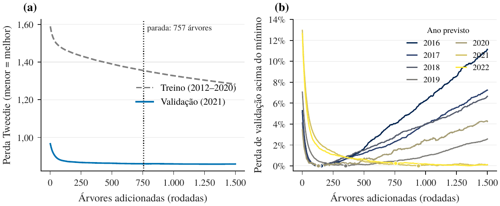
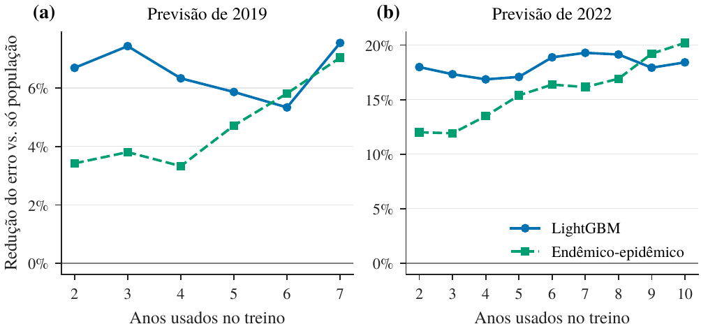
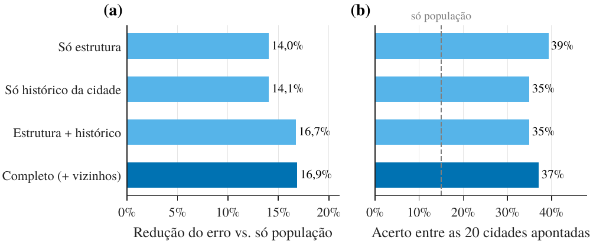
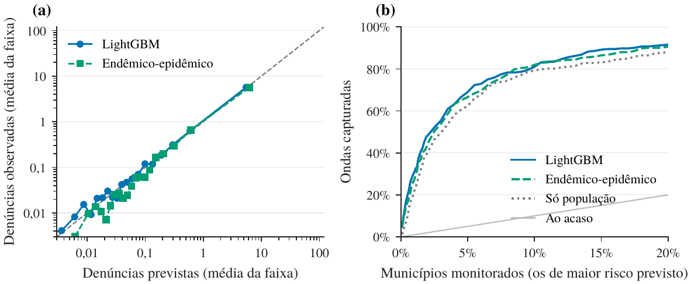
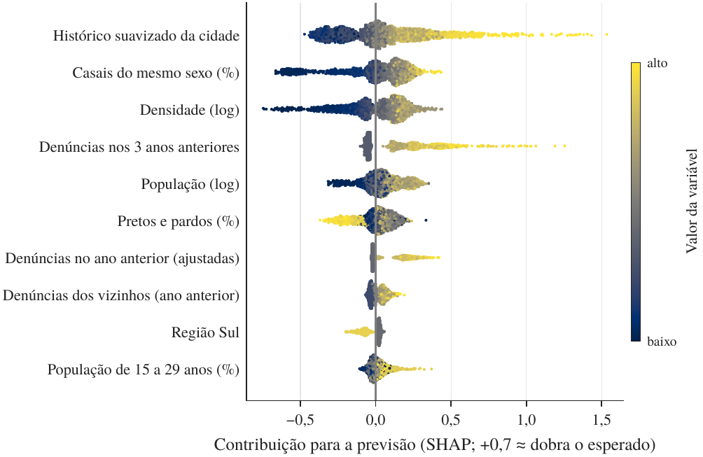
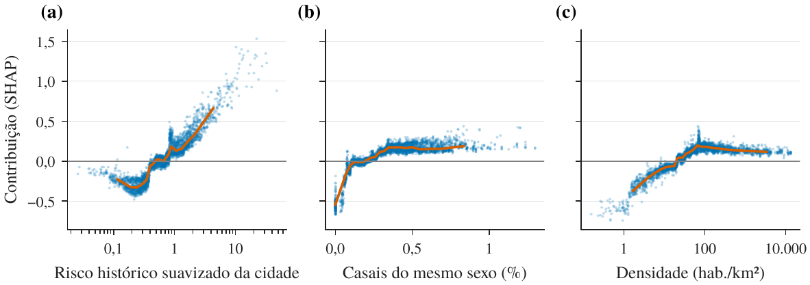

# Relatório Técnico de Modelagem

ACH0042 – Grupo 11 · *Predição de criminalidade contra pessoas trans e travestis*

Documento de apoio à seção **3. Método** do relatório final. Para cada análise, registra o código que a executa, os dados de entrada, o algoritmo e o motivo da escolha, o processo de estimação ou aprendizado (com iterações e tempos medidos), a validação, os resultados e os arquivos para conferência. As fórmulas estão no Apêndice A do relatório; aqui ficam os detalhes de implementação.

---

## 1. Ambiente e reprodutibilidade

| Item | Valor |
|---|---|
| Linguagem | Python 3.13 |
| Bibliotecas | pandas 3.0 · numpy 2.5 · scipy 1.18 · statsmodels 0.15 · scikit-learn 1.9 · LightGBM 4.7 · SHAP 0.54 · esda 2.10 / libpysal 4.15 · geopandas 1.2 · matplotlib 3.11 |
| Máquina da execução | ambiente Linux com 2 núcleos de CPU, sem GPU |
| Aleatoriedade | semente fixa (`seed=42`, `random_state=42`) em todos os modelos e permutações |
| Reprodutibilidade | as quatro análises foram rodadas duas vezes, de forma independente, e deram resultados idênticos |

**Ordem de execução**, com os tempos medidos em 22/11/2026:

| # | Script | Função | Tempo |
|---|---|---|---|
| 0 | `coletar_dados_municipais.py` | baixa os indicadores do IBGE, do Ipea, da MUNIC e do Atlas Brasil | ~2 min (rede) |
| 1 | `limpeza_disque100.py` | limpa e unifica o Disque 100 | 5 s |
| 2 | `montar_painel.py` | monta o painel município × ano e a matriz numérica | 11 s |
| 3 | `a1_previsao_ondas.py` | Análise 1: risco, aglomerados, previsão e alertas | **89 s** |
| 3b | `a1b_aprendizado.py` | Aprofundamento da Análise 1: curvas de aprendizado, tamanho do treino, ablação, *bootstrap*, calibração, sensibilidade e SHAP (seção 9) | **254 s** |
| 4 | `a2_proporcao_trans.py` | Análise 2: proporção de vítimas trans | 1,5 s |
| 5 | `a3_perfil_vitimas.py` | Análise 3: perfil das denúncias trans | 11 s |
| 6 | `a4_its_stf.py` | Análise 4: decisão do STF | 1,5 s |
| 7 | `figuras.py` | figuras do relatório | 4 s |

Todos os scripts das análises usam `comum.py`, que reúne as funções compartilhadas: valor esperado, suavização bayesiana, vizinhança, métricas e quantis da Binomial Negativa. A preparação da Análise 1 (defasagens, histórico suavizado, padronização e o modelo endêmico-epidêmico) fica em `a1_preparacao.py`, usado por `a1_previsao_ondas.py` e `a1b_aprendizado.py`. Essa separação foi verificada: as 10 saídas da Análise 1 ficaram idênticas às anteriores.

---

## 2. Houve processo de aprendizado? Por que foi tão rápido?

**Houve, sim.** Os algoritmos não "rodaram instantaneamente": todos aprenderam os parâmetros a partir dos dados, por processos iterativos. Mas "aprender" significa coisas diferentes em cada família de método.

| Tipo de aprendizado | Onde foi usado | O que acontece |
|---|---|---|
| **Estimação em fórmula fechada** (não iterativa) | Suavização bayesiana empírica (A1) | Os parâmetros α e β da distribuição Gama são calculados diretamente dos dados de todos os municípios (método dos momentos). É estimação estatística, sem ciclos de treino. |
| **Máxima verossimilhança iterativa** | Modelo endêmico-epidêmico (A1); Binomial Negativa da série temporal (A4); regressões binomial (A2) e logística (A3); tendências por cidade (A1) | Um otimizador parte de valores iniciais e ajusta os parâmetros passo a passo até a verossimilhança parar de melhorar. No modelo endêmico-epidêmico, foram **70 a 95 iterações** do otimizador L-BFGS-B por janela, com 1.900 a 2.575 avaliações da função. Os modelos lineares generalizados usam o método de Newton / IRLS, que converge em poucas iterações. |
| **Aprendizado de máquina por *boosting*** | LightGBM (A1 e A3) | Árvores de decisão são adicionadas uma a uma, cada nova árvore corrigindo os erros das anteriores. Uma parte dos dados (o último ano de treino) fica separada para validação, e o treino para quando o erro nela deixa de cair por 100 rodadas seguidas (*early stopping*). Foram de **130 a 942 árvores** por janela. |
| **Aprendizado por conjunto de árvores** | Extra Trees (A1) | São treinadas **300 árvores** independentes, cada uma com sorteio aleatório de variáveis e pontos de corte, e a previsão é a média delas. |
| **Reamostragem** (não é treino) | Gi\* de Getis-Ord (999 permutações); teste de placebo (24 reestimações) | Os dados são embaralhados ou o modelo é reestimado muitas vezes para obter a significância. |

**Evidência do aprendizado.** Janela que prevê 2022, com treino em 2012–2021:

- **Endêmico-epidêmico:** a log-verossimilhança negativa caiu de **22.612** (parâmetros iniciais) para **20.254** em 71 iterações, uma melhora de 2.358 pontos.
- **LightGBM:** as perdas de treino e de validação caem até a validação estabilizar:

| Rodada | Perda no treino | Perda na validação |
|---:|---:|---:|
| 1 | 1,590 | 0,966 |
| 50 | 1,499 | 0,893 |
| 100 | 1,473 | 0,877 |
| 250 | 1,433 | 0,867 |
| 500 | 1,389 | 0,863 |
| **757 (melhor)** | 1,355 | **0,860** |
| 857 (parada) | 1,343 | 0,860 |

A perda de treino continua caindo depois da rodada 757, mas a de validação para de melhorar. Continuar treinando só faria o modelo **decorar** o treino (sobreajuste). Por isso, o treino é interrompido e fica valendo o modelo da rodada 757.

**Por que foi rápido.** Os dados são pequenos para os padrões de aprendizado de máquina: no máximo 55.650 linhas de treino e 24 a 53 variáveis, em formato de tabela. O LightGBM é escrito em C++ e otimizado para esse caso, e os modelos estatísticos têm poucos parâmetros: 24 no modelo endêmico-epidêmico, 53 na logística. Tempos de treino por janela (Análise 1):

| Janela (ano previsto) | Linhas de treino | Endêmico-epidêmico | LightGBM | Extra Trees |
|---|---:|---:|---:|---:|
| 2016 | 22.260 | 2,0 s (70 it.) | 0,7 s (155 árvores) | 2,5 s |
| 2017 | 27.825 | 2,8 s (79 it.) | 0,5 s (130) | 3,1 s |
| 2018 | 33.390 | 3,8 s (95 it.) | 0,7 s (139) | 3,7 s |
| 2019 | 38.955 | 3,1 s (72 it.) | 1,4 s (352) | 4,5 s |
| 2020 | 44.520 | 4,9 s (90 it.) | 0,9 s (131) | 5,3 s |
| 2021 | 50.085 | 4,6 s (76 it.) | 3,8 s (942) | 5,9 s |
| 2022 | 55.650 | 4,8 s (71 it.) | 3,4 s (757) | 6,7 s |

Os 89 s da Análise 1 se dividem entre os 21 treinos acima (~69 s) e o ajuste final, que inclui o cálculo dos erros-padrão por Hessiana numérica, as 999 permutações do Gi\* em dois períodos, o SHAP e as tendências de 136 cidades. Uma rede neural profunda levaria mais tempo, mas não foi usada: com 12 anos de dados e contagens esparsas, ela sobreajustaria sem ganho de precisão.

---

## 3. Análise 1: onde estão os números alarmantes e quais cidades tendem a ter ondas

**Script:** `a1_previsao_ondas.py` · **Entrada:** `painel_municipio_ano.csv` (5.565 municípios × 2011–2022) e centróides municipais · **Unidade:** município × ano

### 3.1 Valor esperado e risco relativo
- **Valor esperado:** E = total nacional do ano × participação do município na população. Trata o volume nacional como cenário e isola a distribuição entre cidades.
- **Suavização bayesiana empírica** (Poisson-Gama, estimador de Marshall). Calculada para 2011–2022 e para 2020–2022. Município **alarmante:** P(RR > 1) > 0,95.
- **Resultado:** 141 municípios alarmantes em 2020–2022, dos quais 83 têm menos de 100 mil habitantes. Os riscos mais altos são Ubaporanga/MG (RR 29,3), Itaporanga/PB (24,6), Cabo Frio/RJ (16,9), Barbacena/MG (10,4) e Campos dos Goytacazes/RJ (8,1).

### 3.2 Aglomerados (Gi\* de Getis-Ord)
- 10 vizinhos mais próximos pelo centróide, pesos padronizados por linha, 999 permutações, aplicado ao RR suavizado.
- **Aglomerado alto:** Gi\* > 0, p < 0,05 e o próprio RR > 1.
- **Resultado:** 61 municípios em 2020–2022 e 98 em 2011–2022, em MG (Zona da Mata e Sul de Minas), na região metropolitana do RJ, em SP, em GO e na região de João Pessoa/PB.
- **Correção feita durante a análise:** a primeira versão aplicou o Gi\* sobre o log do RR. A estatística exige valores não negativos, e o erro gerou 595 falsos aglomerados, 80% deles com zero registros. Corrigido para o RR em si.

### 3.3 Tendência relativa por cidade
- Regressão de Poisson por cidade, com *offset* log(E), inclinação no ano e erro quase-Poisson. Aplicada às 136 cidades com pelo menos 30 registros.
- **Resultado:** 18 em alta, 15 em queda e 103 estáveis. Maiores altas: Juazeiro/BA (+69%/ano), Itaporanga/PB (+68%), Barbacena/MG (+49%).

### 3.4 Previsão um ano à frente

**Variáveis.** As do componente estrutural são: log população, log densidade, log renda, log PIB per capita (t−1), log taxa de homicídios (t−1), Gini, % de 15 a 29 anos, % de pretos e pardos, % de casais do mesmo sexo, índice LGBT da MUNIC, ouvidoria, estrutura de direitos humanos, Processo Transexualizador, capital e região. Os modelos de árvore recebem também log(1 + procedimentos), log(1 + y em t−1), log(1 + média dos vizinhos em t−1), log(1 + soma dos 3 anos anteriores), log do RR histórico suavizado e y em t−1 ajustado pelo volume nacional. O IDHM foi excluído por colinearidade com a renda (ρ = 0,90; VIF 7,0 e 8,4).

**Modelos:**

| Modelo | Implementação | Configuração |
|---|---|---|
| Endêmico-epidêmico Binomial Negativo | próprio, em `scipy.optimize` (L-BFGS-B), forma aditiva do `hhh4` | 19 coeficientes estruturais + 4 de inércia/vizinhança + dispersão; erros-padrão por Hessiana numérica |
| LightGBM | `lightgbm`, objetivo Tweedie (potência 1,3), *offset* log(E) via `init_score` | taxa de aprendizado 0,03; 15 folhas; mínimo de 60 por folha; 80% de variáveis e de linhas por árvore; L2 = 1; *early stopping* de 100 rodadas no último ano de treino; depois, retreino no treino completo com o nº de árvores escolhido |
| Extra Trees | `scikit-learn`, critério de Poisson | 300 árvores; mínimo de 20 por folha; 50% das variáveis por divisão; log(E) como variável |
| Referências | — | só população (μ = E); fatia histórica do município × total do ano; ano anterior × razão nacional |

**Validação.** Janela móvel com origem expansível: treina de 2012 até t−1 e prevê t, para t = 2016…2022 (7 janelas). A padronização é recalculada só com o treino de cada janela.

| Modelo | Desvio de Poisson | Redução vs. só população | MAE | Acerto top-50 | Precisão média (onda) | Precisão nas 20 primeiras (onda) |
|---|---:|---:|---:|---:|---:|---:|
| LightGBM | 0,633 | **+16,7%** | 0,296 | 66,0% | 0,224 | **37,1%** |
| Endêmico-epidêmico | 0,649 | +14,6% | 0,316 | 63,4% | 0,196 | 31,4% |
| Extra Trees | 0,674 | +11,3% | 0,347 | 63,1% | 0,207 | 31,4% |
| Só população | 0,760 | — | 0,380 | 63,1% | 0,140 | 15,0% |
| Fatia histórica | 0,872 | −14,7% | 0,322 | 60,9% | 0,183 | 28,6% |
| Ano anterior | 1,033 | −35,8% | 0,380 | 54,9% | 0,133 | 25,7% |

Onda = pelo menos 5 registros e pelo menos 2 × E. A probabilidade de onda é P(Y ≥ limiar) pela Binomial Negativa com a média prevista por cada modelo e a dispersão do modelo endêmico-epidêmico.

**Coeficientes do ajuste final (2012–2022).** RR por desvio-padrão; para as binárias, efeito de 0 para 1.

| Variável | RR | IC 95% | p |
|---|---:|---|---:|
| Casais do mesmo sexo | 1,125 | 1,076–1,177 | <0,001 |
| Densidade | 1,124 | 1,070–1,181 | <0,001 |
| População | 1,080 | 1,018–1,146 | 0,010 |
| Pretos e pardos | 0,917 | 0,856–0,983 | 0,014 |
| Ouvidoria (0→1) | 1,228 | 1,100–1,370 | <0,001 |
| Centro-Oeste / Sul / Norte (vs. Sudeste) | 1,36 / 0,72 / 0,58 | — | <0,001 |
| Renda, PIB, Gini, homicídios, % 15–29, índice LGBT, estrutura de direitos humanos, Processo Transexualizador, capital, Nordeste | ≈1 | incluem 1 | >0,05 |
| Inércia (intercepto; por DP de log pop.) | 0,124; 1,300 | — | <0,001 |
| Vizinhança (intercepto) | 0,005 | 0,002–0,016 | <0,001 |
| Dispersão BN (tamanho θ) | 0,307 | — | — |

**Decomposição do valor previsto:** 73,6% estrutural, 26,1% inércia e 0,3% vizinhança, estável entre os anos (vizinhança sempre entre 0,3% e 0,4%).

**Importância das variáveis no LightGBM** (SHAP médio absoluto, amostra de 5.000 linhas): RR histórico suavizado (0,178) > % de casais do mesmo sexo (0,144) > densidade (0,133) > soma dos 3 anos anteriores (0,084) > % de pretos e pardos (0,076) > população (0,065).

### 3.5 Alertas de onda
- **Alerta:** y > percentil 95 da Binomial Negativa prevista pelo modelo endêmico-epidêmico, com y ≥ 3. **Alerta forte:** acima do percentil 99.
- **Resultado:** 22 a 52 alertas por ano (10 a 35 fortes). P(alerta em t+1 | alerta em t) = 4,1%, contra 0,73% de base, ou seja, **5,7 vezes** maior.
- **Alertas mais recorrentes:** Cambuí/MG (4 anos), Cajazeiras/PB, Itaporanga/PB, Guaraniaçu/PR, Ouricuri/PE, Ubaporanga/MG, Caratinga/MG e Muriaé/MG (3 anos cada).
- **Vigilância 2023** (cenário com o mesmo volume nacional de 2022): Barbacena/MG 40%; Fortaleza, Cabo Frio, São Paulo, Campo Grande, Rio de Janeiro e Santos com 30% a 32%.

### 3.6 Arquivos para conferência
`a1_validacao_resumo.csv`, `a1_validacao_por_ano.csv`, `a1_log_treinamento.csv`, `a1_coeficientes_endemico_epidemico.csv`, `a1_decomposicao_por_ano.csv`, `a1_importancia_shap.csv`, `a1_risco_municipal.csv` (RR, P, Gi\* e tendência por município), `a1_cidades_alerta_recorrente.csv`, `a1_vigilancia_2023.csv`, `a1_previsoes_validacao.csv`, `a1_resumo.json`.

---

## 4. Análise 2: proporção de vítimas trans por município

**Script:** `a2_proporcao_trans.py` · **Unidade:** município × ano com pelo menos 1 registro na janela identificável · **n** = 5.339 observações, 2.070 municípios

- **Modelo:** GLM binomial (`statsmodels`, IRLS). A resposta é a fração de registros trans entre os registros LGBT da janela; o peso é o nº de registros. Erros-padrão agrupados por município (*cluster-robust*); efeitos fixos de ano; variáveis contínuas padronizadas.
- **Janelas identificáveis:** jan/2011–jun/2020 e jul/2022–dez/2022.
- **Sobredispersão:** estatística de Pearson / gl = 1,82 (principal), 1,94 (sem efeito de ano) e 2,92 (só capitais). Os erros agrupados por município corrigem a inferência.
- **Robustez:** modelo sem efeito de ano e modelo só com as 27 capitais (285 observações).

| Variável (modelo principal) | Razão de chances | IC 95% | p |
|---|---:|---|---:|
| Nordeste (vs. Sudeste) | 1,54 | 1,12–2,12 | 0,009 |
| Densidade (por DP) | 0,83 | 0,73–0,95 | 0,007 |
| Pretos e pardos (por DP) | 0,77 | 0,61–0,97 | 0,026 |
| Processo Transexualizador | 0,84 | 0,62–1,13 | 0,24 |
| Índice LGBT (por DP); só capitais | 0,95; **0,79** | 0,87–1,04; 0,68–0,91 | 0,27; 0,001 |

**Descritivo:** proporção trans de 18,2% no total; 17,2% nos municípios alarmantes contra 19,1% nos demais; 15,7% nas capitais com Processo Transexualizador ativo contra 20,6% nas capitais sem. Por ano, a proporção vai de 8,0% (2020) a 30,7% (2018).

**Arquivos:** `a2_coeficientes_principal.csv`, `a2_coeficientes_sem_efeito_ano.csv`, `a2_coeficientes_so_capitais.csv`, `a2_proporcao_por_grupo.csv`, `a2_proporcao_por_ano.csv`.

---

## 5. Análise 3: perfil das denúncias com vítima trans

**Script:** `a3_perfil_vitimas.py` · **Unidade:** registro com identidade conhecida · **n** = 16.467 (4.431 trans, 26,9%) · **53 preditores**

- **Preditores:** 9 tipos de violação; local (ref. residência); relação com o agressor (ref. familiar); faixa etária (ref. 18–24); raça/cor (ref. branca); região; efeito fixo de ano. Categorias com menos de 20 registros foram removidas.
- **Variáveis excluídas por vazamento:** identidade de gênero, orientação sexual e sexo, porque em 2022 a identidade trans era registrada no campo de orientação. Denunciante e canal também ficaram de fora, por existirem só a partir de 2020.
- **Logística:** `statsmodels` Logit (Newton), erros agrupados por município. Pseudo-R² de McFadden = 0,127.
- **LightGBM classificador:** 400 rodadas fixas, taxa 0,03, 15 folhas, mínimo de 40 por folha. Validação cruzada **agrupada por município** (5 partições), para que um mesmo município nunca esteja ao mesmo tempo no treino e no teste.

| Validação (AUC fora da amostra) | Valor |
|---|---:|
| Só efeitos de ano (referência) | 0,649 |
| Regressão logística | **0,708** |
| LightGBM | 0,704 |

O LightGBM não supera a logística, o que indica efeitos majoritariamente aditivos, sem interações relevantes.

| Característica | Razão de chances | IC 95% |
|---|---:|---|
| Violação contra a vida | 3,03 | 2,35–3,91 |
| Agressor profissional/institucional | 2,25 | 1,47–3,44 |
| Agressor em relação de trabalho | 1,92 | 1,38–2,66 |
| Violência sexual | 1,70 | 1,26–2,28 |
| Agressor desconhecido da vítima | 1,70 | 1,34–2,15 |
| Raça/cor não informada | 1,70 | 1,42–2,04 |
| Violência física | 1,41 | 1,17–1,69 |
| 25–29 anos | 1,29 | 1,00–1,66 |
| Via pública / transporte | 1,28 | 1,04–1,56 |
| Psicológica | 0,81 | 0,70–0,93 |
| Discriminação | 0,78 | 0,67–0,91 |
| Local de trabalho | 0,71 | 0,52–0,98 |
| 0–17 anos | 0,54 | 0,36–0,81 |
| 60 anos ou mais | 0,30 | 0,16–0,56 |

**Qualidade do registro:** raça/cor ausente em 30,4% dos registros trans contra 15,8% nos demais; relação com o agressor ausente em 41,4% contra 23,4%.

**Arquivos:** `a3_logistica_razoes_chance.csv`, `a3_auc.csv`, `a3_importancia_shap.csv`, `a3_perfil_descritivo.csv`.

---

## 6. Análise 4: decisão do STF (série temporal interrompida)

**Script:** `a4_its_stf.py` · **Unidade:** mês · **Séries:** total LGBT (144 meses, 2011–2022); vítimas trans e proporção trans (114 meses, jan/2011–jun/2020)

- **Modelo:** Binomial Negativa (`statsmodels` `NegativeBinomial`, máxima verossimilhança) para as contagens; binomial (GLM) para a proporção.
- **Termos do modelo:** tendência, degrau e inclinação a partir de jun/2019, Fourier com 2 harmônicos de 12 meses.
- **Controles:** pandemia (mar/2020–dez/2021), novo sistema (≥ jul/2020) e nova ficha (≥ jul/2022).
- **Erros-padrão:** Newey-West (HAC) com 6 defasagens.
- **Robustez:** excluindo 2012 (pico atípico) e restringindo o total LGBT à janela até jun/2020.
- **Placebo:** reestimação com a quebra em cada mês de jan/2018 a dez/2019 (24 modelos), comparando a log-verossimilhança.

| Série | Nível após a decisão (IC 95%) | Tendência/mês | Leitura |
|---|---|---|---|
| Total LGBT 2011–2022 | 0,98 (0,67–1,43) | 1,028 (1,005–1,052) | sem degrau; inclinação frágil |
| Total LGBT sem 2012 | 0,85 (0,61–1,19) | 1,021 (1,000–1,042) | idem |
| Total LGBT até jun/2020 | 0,84 (0,61–1,16) | 1,044 (0,98–1,11) | sem efeito |
| Vítimas trans até jun/2020 | 0,52 (0,33–0,80) | 1,009 (0,95–1,07) | queda (ver placebo) |
| Vítimas trans sem 2012 | 0,46 (0,30–0,72) | 0,990 | idem |
| Proporção trans até jun/2020 | 0,54 (0,38–0,75) | 0,963 (0,90–1,03) | idem |

**Controles:** novo sistema RR 0,41 (−59%); nova ficha 2022 RR 4,52; pandemia 1,48 na série completa.

**Placebo:** o melhor ponto de quebra é **fev/2019**, com log-verossimilhança 6,3 maior que a de jun/2019. Todos os meses depois de jun/2019 ajustam pior. A categoria "travesti" cai de 32 registros (4.º tri/2018) para 9 (1.º tri/2019). **Conclusão:** a queda é anterior à decisão, é compatível com uma mudança de registro, e o efeito da decisão não é identificável com estes dados.

**Arquivos:** `a4_its_coeficientes.csv`, `a4_placebo_quebra.csv`, `a4_registro_identidade_trimestre.csv`, `a4_serie_lgbt.csv`, `a4_serie_trans.csv`.

---

## 7. Checagens e correções feitas durante o processo

| Etapa | Problema encontrado | Como foi detectado | Correção |
|---|---|---|---|
| Limpeza | Formato 2020–2022 com 1 linha por violação (o total de 2022 parecia 20 mil) | contagem de linhas por `hash` | agregação por denúncia × vítima |
| Limpeza | "Discriminação por orientação **sexual**" contada como violência sexual (47%) | distribuição implausível das categorias | classificação descrição a descrição, com regras em ordem de prioridade |
| Limpeza | Identidade trans tratada como registrável em todo 2022 | a série trans ficava zerada de jan a jun/2022 | janela corrigida para jul/2022 em diante; reprocessamento completo |
| Coleta | "-" do SIDRA (= zero) lido como ausente: 6,9% sem dado de casais do mesmo sexo | log da coleta | convertido para 0 |
| Painel | PIB per capita negativo (1 caso) | checagem de valores negativos | interpolado com os anos vizinhos |
| Análise 1 | Gi\* sobre log(RR), que é negativo, gerando 595 falsos aglomerados | 80% dos aglomerados tinham 0 registros | Gi\* sobre o RR, exigindo RR > 1 |
| Análise 4 | Queda trans atribuída ao STF | teste de placebo | reinterpretada como mudança de registro |
| Modelagem | Vazamento de informação na matriz por registro | identidade e orientação "entregavam" a resposta | variáveis removidas |
| Modelagem | Padronização calculada com toda a base | revisão do desenho da validação | padronização refeita dentro de cada janela de treino |

## 8. Limitações técnicas

- **Denúncias não são ocorrências:** o Disque 100 mede violência e propensão a denunciar ao mesmo tempo, e os modelos não separam as duas coisas.
- **Volume nacional não previsto:** ele é tratado como cenário. As previsões só valem dado o total do ano.
- **Processo Transexualizador:** só 10 municípios tiveram o serviço ativo no período, o que dá baixo poder estatístico.
- **Dados estáticos:** casais do mesmo sexo (2022), Gini e IDHM (2010) não variam no tempo. As variáveis censitárias são interpoladas linearmente entre 2010 e 2022.
- **MUNIC:** a edição de 2014 foi usada para 2011–2013. O conselho de direitos humanos não é comparável entre edições.
- **Identidade trans não registrada** em jul/2020–jun/2022, o que reduz a série trans pós-STF a 13 meses.
- **Vizinhança:** definida pelos 10 municípios mais próximos pelo centróide, e não por fronteira. Uma definição por contiguidade pode mudar levemente o Gi\* e o componente de vizinhança.

---

## 9. Aprofundamento da Análise 1: como o LightGBM aprende e por que confiar nos resultados

**Script:** `a1b_aprendizado.py` (254 s) · **Figuras:** `fig5` a `fig10` em `figuras/` · **Saídas:** `resultados/a1b_*.csv` e `a1b_resumo.json`

Usa os mesmos dados, variáveis e protocolo de validação da Análise 1: janela móvel 2016–2022, parada antecipada com 100 rodadas de paciência no último ano de treino e retreino com o número de árvores escolhido.

> **Nota sobre as duas formas de resumir o ganho.** Os 16,7% da Tabela 3 do relatório correspondem a 1 − (desvio médio do modelo ÷ desvio médio da referência), o mesmo critério do *bootstrap*. Os 16,9% desta seção são a média dos ganhos de cada ano. Ano a ano, os valores são idênticos aos da Análise 1.

### 9.1 Curvas de aprendizado (Figura 5)

O LightGBM foi treinado por 1.500 rodadas, sem parar, registrando a perda Tweedie (log-verossimilhança negativa média) no treino e no ano reservado para validação. O ponto de parada foi reconstruído com a mesma regra usada no modelo final (melhor rodada antes de 100 rodadas sem melhora).

| Ano previsto | Árvores escolhidas | Queda da perda de validação até a parada | Queda da perda de treino até 1.500 | Validação em 1.500 vs. na parada |
|---|---:|---:|---:|---:|
| 2016 | 155 | −5,0% | −23,6% | **+11,1%** |
| 2017 | 130 | −4,9% | −22,6% | +7,2% |
| 2018 | 139 | −4,0% | −21,5% | +6,7% |
| 2019 | 352 | −6,6% | −20,2% | +2,6% |
| 2020 | 131 | −3,3% | −19,4% | +4,2% |
| 2021 | 942 | −11,5% | −19,3% | +0,1% |
| 2022 | 757 | −11,0% | −19,3% | −0,1% |

**Leitura:** a perda de treino cai sempre, de 19% a 24%, porque o modelo continua se ajustando aos dados que vê. A de validação cai de 3% a 11% e depois **volta a subir** nos primeiros anos (até +11%): é o sobreajuste. Nos anos mais recentes, com mais dados de treino, a validação estabiliza em vez de subir. A parada antecipada escolhe sempre o ponto de mínimo.

### 9.2 Quantos anos de dados o modelo precisa (Figura 6)

Os anos de 2019 e 2022 foram previstos usando apenas os *k* anos imediatamente anteriores, com *k* de 2 a 7 (2019) e de 2 a 10 (2022). Com *k* = 1 não há ano reservado para a parada antecipada, e o LightGBM com 300 rodadas fixas sobreajusta (−21% em 2022), por isso esse ponto fica fora da figura.

| Anos de treino | 2019: LightGBM | 2019: endêmico-epidêmico | 2022: LightGBM | 2022: endêmico-epidêmico |
|---:|---:|---:|---:|---:|
| 2 | 6,7% | 3,4% | 18,0% | 12,0% |
| 3 | 7,4% | 3,8% | 17,3% | 11,9% |
| 4 | 6,3% | 3,3% | 16,9% | 13,5% |
| 5 | 5,9% | 4,7% | 17,1% | 15,4% |
| 6 | 5,3% | 5,8% | 18,9% | 16,4% |
| 7 | 7,5% | 7,0% | 19,3% | 16,2% |
| 8 | — | — | 19,1% | 16,9% |
| 9 | — | — | 17,9% | 19,2% |
| 10 | — | — | 18,4% | 20,2% |

**Leitura:** o LightGBM aprende rápido. Com 2 a 3 anos de dados já atinge quase todo o seu desempenho, e depois oscila. O endêmico-epidêmico melhora de forma mais contínua com mais anos e alcança o LightGBM com 6 a 9 anos. Há dois perfis de modelo: o de aprendizado de máquina extrai mais com pouco histórico, e o estatístico se beneficia mais de séries longas. 2019 é um ano difícil para todos os modelos (ganhos de no máximo 7,5%), coerente com a queda atípica de registros nesse ano.

### 9.3 De onde vem o ganho: ablação (Figura 7)

O LightGBM foi retreinado nas 7 janelas com subconjuntos de variáveis:

| Conjunto | Nº de variáveis | Redução do erro (média anual) | Precisão média (onda) | Acerto nas 20 primeiras (onda) |
|---|---:|---:|---:|---:|
| Só estrutura (características do município) | 19 | 14,0% | 0,219 | 39% |
| Só histórico da cidade | 4 | 14,1% | 0,211 | 35% |
| Estrutura + histórico | 23 | 16,7% | 0,222 | 35% |
| Completo (+ vizinhos) | 24 | 16,9% | 0,224 | 37% |

**Leitura:**
- Estrutura e histórico carregam **informações complementares**: juntos, superam cada um isolado em todos os 7 anos.
- Os vizinhos acrescentam apenas **0,15 ponto**. Isso confirma, por outro método, o componente de vizinhança de 0,3% do modelo endêmico-epidêmico: as ondas são locais.
- Para apontar as 20 cidades com maior chance de onda, a estrutura sozinha basta (39%), o que mostra que o risco de onda é sobretudo estrutural.

### 9.4 Incerteza do ganho: *bootstrap* por município

O *bootstrap* reamostra **municípios**, e não linhas, preservando a dependência entre os anos do mesmo município. Foram 2.000 reamostras sobre as previsões fora da amostra da Análise 1.

| Comparação | Ganho | IC 95% | P(ganho ≤ 0) |
|---|---:|---|---:|
| LightGBM vs. só população | 16,7% | 13,3% a 20,3% | < 0,001 |
| Endêmico-epidêmico vs. só população | 14,6% | 11,0% a 18,7% | < 0,001 |
| Extra Trees vs. só população | 11,3% | 6,9% a 15,2% | < 0,001 |
| LightGBM vs. endêmico-epidêmico (p.p.) | 2,1 | 0,1 a 4,2 | 0,02 |

**Consistência ano a ano:** os três modelos superam a referência populacional em **7 de 7 anos**, e o LightGBM supera o endêmico-epidêmico em 6 de 7 (a exceção é 2022: 18,4% contra 20,2%).

### 9.5 Calibração e captura de ondas (Figura 8)

**Calibração.** As previsões fora da amostra (7 anos × 5.565 municípios) foram divididas em 20 faixas de igual tamanho pelo valor previsto, comparando a média prevista com a observada em cada faixa. Os pontos seguem a diagonal ao longo de quatro ordens de grandeza, de 0,004 a 6 denúncias por município-ano. Totais previstos em relação ao observado:

| Modelo | Total previsto ÷ observado |
|---|---:|
| LightGBM | 0,96 |
| Endêmico-epidêmico | 1,10 |
| Extra Trees | 1,05 |

**Captura de ondas.** Em cada ano, os municípios foram ordenados pela probabilidade prevista de onda, e foi medida a fração das 332 ondas de 2016–2022 que cai entre os x% primeiros:

| Municípios monitorados | LightGBM | Endêmico-epidêmico | Só população |
|---|---:|---:|---:|
| 1% (~56 por ano) | **30,7%** | 27,1% | 21,7% |
| 5% (~278) | **69,0%** | 66,6% | 62,3% |
| 10% (~557) | 81,0% | 81,9% | 79,2% |

**Leitura:** a vantagem dos modelos está no topo da lista. Com orçamento de atenção pequeno (1%), o LightGBM captura 41% mais ondas que a regra populacional. Com 10%, os três convergem, porque qualquer lista desse tamanho já inclui as cidades grandes.

### 9.6 Sensibilidade aos hiperparâmetros

Cada parâmetro foi alterado um de cada vez em relação à configuração usada:

| Variante | Ganho médio anual | Mínimo–máximo entre anos |
|---|---:|---|
| **Configuração usada** (15 folhas, taxa 0,03, mín. 60 por folha, Tweedie 1,3, 80% de amostragem) | 16,9% | 7,5%–24,8% |
| Folhas = 7 | 16,2% | 7,1%–24,7% |
| Folhas = 31 | 16,8% | 7,6%–26,4% |
| Taxa de aprendizado = 0,1 | 15,9% | 6,9%–23,1% |
| Mínimo por folha = 20 | 16,4% | 6,5%–26,2% |
| Mínimo por folha = 150 | 17,3% | 7,6%–26,1% |
| Potência Tweedie = 1,2 | 16,7% | 5,9%–24,6% |
| Potência Tweedie = 1,5 | 15,7% | 6,2%–27,7% |
| Sem amostragem de variáveis e linhas | 15,8% | 6,3%–25,0% |

**Leitura:** o ganho varia entre 15,7% e 17,3%. A conclusão não depende de ajuste fino. Os hiperparâmetros não foram otimizados contra os anos de teste: a configuração foi fixada antes da validação, e esta tabela é só de verificação.

### 9.7 O que o modelo aprendeu: SHAP (Figuras 9 e 10)

Os valores SHAP (TreeExplainer) foram calculados para o modelo treinado com todos os anos (número de árvores = mediana da validação), numa amostra de 4.000 municípios-ano: 2.000 com e 2.000 sem registros, para os casos com denúncia não ficarem sub-representados. Participação na importância total (média de |SHAP|):

| Variável | Participação |
|---|---:|
| Histórico suavizado da cidade | 17,8% |
| Casais do mesmo sexo (%) | 13,4% |
| Densidade | 13,2% |
| Denúncias nos 3 anos anteriores | 12,0% |
| População | 7,4% |
| Pretos e pardos (%) | 6,7% |
| Denúncias no ano anterior (ajustadas) | 5,7% |
| Denúncias dos vizinhos | 3,5% |
| Região Sul | 3,1% |
| População de 15 a 29 anos | 2,8% |

**Relações aprendidas** (Figura 10, dependência):
- **Histórico suavizado:** efeito crescente e aproximadamente linear no log a partir de RR ≈ 0,3. Cidades historicamente acima do esperado continuam acima.
- **Casais do mesmo sexo:** efeito fortemente negativo perto de 0% e positivo, mas estável, a partir de cerca de 0,3%. O modelo aprendeu um **limiar**, não uma relação linear.
- **Densidade:** cresce até cerca de 100 hab./km² e depois se estabiliza.

Essas formas são coerentes com os coeficientes do modelo endêmico-epidêmico (seção 3.4), obtidos sem nenhuma suposição em comum. As escalas de SHAP estão em log da taxa: +0,7 ≈ dobra o esperado.

